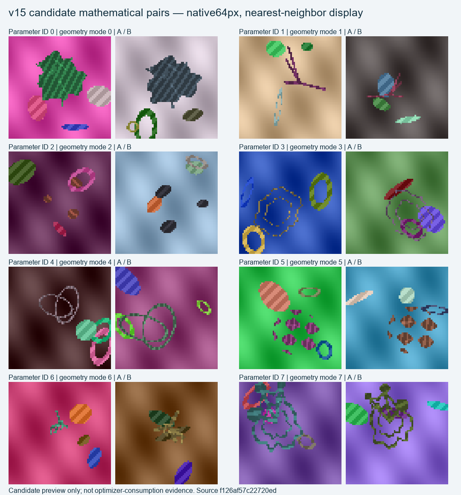

# HyperNet v15: mathematical-only dense detail pretraining

This isolated experiment learns local visual correspondences from sharp, procedurally generated 2D patterns. Its 9,281-parameter CNN preserves a stride-1 detail path and uses invertible pixel unshuffle before context compression. It produces 24-dimensional descriptors at every input pixel. These are local pattern features, not a semantic object classifier.

The complete pipeline is **not lossless**. Pixel unshuffle is invertible before the subsequent learned compression. Real-image inference keeps native pixels in overlapping tiles, then the GravitySpy matcher samples descriptors every **4 pixels** and Grid every **2 pixels**. It does not retain every pixel descriptor for matching. The measured evidence is improved held-out correspondence and selected small-pattern sensitivity, not preservation of every minute detail.

The completed training run consumed **1,048,576 parameter families and 2,097,152 unique rendered RGB views**, with no borrowed pretrained weights, natural-image gradient training, teacher model, or text supervision. SHA-256 census found **1,048,576 distinct canonical geometry-plus-material rasters and 949,628 distinct binary silhouettes**. This is eight mathematical formula modes with many parameter settings, not a million unrelated shape classes or a million semantic categories.

The eight modes combine Fourier domains, junction graphs, component unions, nested contours, intersecting ellipses, oscillatory level sets, anisotropic ridges, and mixed contour/graph structures. Bounded Gaussian parameter changes, crisp small-scale patterns, independent appearance/background clutter, and known affine views provide dense correspondence supervision. Gaussian variation alone is not a novelty claim: synthetic geometric pretraining and dense correspondence learning have substantial prior work.



Preview generation is separate from the audited optimizer-consumption ledger. `assets/training_latest.png` shows a batch actually consumed by the completed run.

## Measured synthetic result

All four checkpoints use identical held-out parameter IDs, views, and 7,680 sampled anchors from 240 usable families out of 256. Every one of the 4,096 target-image pixels, including background and clutter, is a search candidate. PCK means the predicted corresponding point lies within the stated pixel distance of the known continuous warp target; it is not category accuracy.

| Training families | PCK within 2px | PCK within 4px |
|---:|---:|---:|
| 0, random initialization | 1.73% | 5.05% |
| 65,536 | 18.75% | 31.05% |
| 262,144 | 30.51% | 47.01% |
| **1,048,576, predeclared final** | **39.47%** | **56.42%** |

The final checkpoint was selected by the declared training budget, not by a test score. The smaller checkpoints are scaling controls from the same single training trajectory; they are not independent training seeds. Anchors can repeat within small families and should not be treated as 7,680 independent observations.

Held-out parameter IDs, canonical material rasters, and RGB views have zero exact overlap with training. **28 of 256 held-out silhouettes do occur in training.** A posthoc grouping of saved predictions yields 39.12%/55.67% PCK for the 228 silhouette-unseen families (216 usable, 6,912 anchors), versus 42.58%/63.15% for the silhouette-seen group (24 usable, 768 anchors). All function modes are shared; a different hash does not rule out near duplicates. Sixteen families lack conservative bilinear foreground support and are excluded from correspondence metrics, not silently counted as successes.

Native 1–3px probes show that single-pixel changes remain visible to the learned descriptors. Their reconstruction errors improve over random initialization, but do not improve monotonically at every checkpoint. Sensitivity is not itself recognition accuracy and may trade off against noise robustness.

## One reference image

The included CLI enrolls one image using frozen mathematical-only weights. Pattern mode returns whole-image pattern similarity with geometric consistency; anomaly mode uses one normal reference and returns local-detail deviations. Neither mode updates weights from the reference or query. Scores are not calibrated probabilities. The optional threshold requires separate domain-specific calibration; without one the CLI makes no alarm decision.

From **this experiment directory**, with a compatible PyTorch installation:

```powershell
python -m pip install -r requirements.txt
python scripts/one_reference_patterns.py --checkpoint checkpoints/details_run01/families_1048576.pt --reference reference.png --query query.png --mode pattern --device cpu --output result.json
```

Use `--mode anomaly` when the reference depicts the normal texture. Use `--device cuda` with a compatible GPU installation. This command never downloads model weights. The staged identity smoke is only a plumbing check, not evidence of real-domain recognition.

Real-image research is separate from the synthetic result. The completed MVTec Grid pilot uses **one normal reference plus 64 additional normal development images for threshold calibration**; GravitySpy uses one reference per available pattern class plus separate real calibration/development images. Those extra real images must be reported even though they do not train the CNN's weights. This staging package contains no real benchmark images. It does not claim a win over published models, general object detection, or human-like category learning.

## Real-image result: MVTec Grid failed to transfer

On the unchanged official Grid TEST split, the final model detected **0 of 57 defective images**, while flagging **4 of 21 normal images**. Its image AUROC was **0.188**, below the same-architecture random initialization's **0.430**. The random control detected 2/57 defects with 2/21 false alarms; the fixed analytic control detected 1/57 with 5/21 false alarms. Thresholds were fixed from the separate 64 normal DEV images before TEST.

The final model's normalized false-alarm estimate is **1,905 per 10,000**, with a 95% exact-binomial reference interval of **545–4,191 per 10,000**. The actual negative sample is only **21 images**, not 10,000; the interval assumes independent samples. The useful synthetic correspondence result therefore does not establish useful anomaly detection on this real domain. Image-level thresholds and ranking both failed; no post-TEST threshold reversal or model selection was applied.

[Grid evidence and reproduction notes](benchmarks/grid/README.md) include compact score arrays, original/public metadata hashes, the frozen sources, and an independent audit of all 234 image scores plus two exact RGB inference replays across three methods. Public metadata replaces local absolute paths and has different hashes where transformed. It is historical evidence, not an executable admission for a new machine. No photos, ground-truth masks, predicted maps, or real-image figures are bundled.

## Real-image result: GravitySpy did not beat raw correlation

Across 4,044 fresh TEST spectrogram events in 3,954 time groups, the final CNN's mean per-target recall was **3.64%**, with **18.89 false alarms per 10,000 negatives** as a normalized per-target mean. A cheap 48×48 grayscale correlation control achieved **19.70% recall and 11.37 FP/10k**. When all 19 targets are screened jointly, the final model produced 134 wrong-target alarm events; raw48 produced 81. These are separate metrics, not classification accuracy or evidence of a 10,000-negative test.

The predeclared paired time-group analysis gives final recall a 95% interval of **2.77%–4.61%**. The final-minus-random recall interval includes zero, so this benchmark does **not demonstrate a recall gain over random initialization**. Final-minus-raw48 recall is **−16.06 percentage points**, with a 95% interval of **−17.95 to −14.11 points**.

This evaluation uses **19 reference images plus 1,579 labeled CALIB events**, with no real-image gradient updates. Three references and 567 CALIB events were previously used in older benchmark groups; previously exposed groups were excluded from TEST. A fixed blind rule excluded 75 exactly constant TEST plots from 4,119 candidates without replacement. The [six-arm GravitySpy evidence](benchmarks/gravity_spy/README.md) includes all controls, paired time-group uncertainty, compact scores and independently audited results. No real images are bundled.

The synthetic objective learns two views of the same exact canonical pattern. It does not directly train independent same-type examples or normal-versus-defect distinctions. The [source-based objective review](benchmarks/gravity_spy/provenance/experiments/v15_objective_scope_review.json) records that mismatch and untested future hypotheses. The reported failures are preserved; no TEST-based model promotion, score reversal or threshold adjustment was applied.

## Reproduce training and diagnostics

The recorded environment used Python 3.12.10, PyTorch 2.14.1+cu130, NumPy 2.5.3, Pillow 12.3.0, and an NVIDIA RTX 5070 Laptop GPU. Install the PyTorch build appropriate for your system using the [official PyTorch instructions](https://pytorch.org/get-started/locally/). `requirements.txt` records the other runtime/test packages. Different devices/library versions can change pixel rounding and floating-point results; byte-exact audit replay requires the admitted environment.

```powershell
python -m pytest -q tests
python scripts/train_details.py --mode smoke --renderer torch --device cuda --families 1024 --validation-families 128 --batch-size 256 --side 64 --threads 4 --prefetch-workers 1 --output checkpoints/reproduction_smoke
python scripts/train_details.py --mode train --renderer torch --device cuda --families 1048576 --validation-families 256 --batch-size 256 --side 64 --threads 4 --prefetch-workers 1 --checkpoint-every 65536 --output checkpoints/reproduction_full
python scripts/evaluate_detail_correspondence.py --checkpoint checkpoints/details_run01/families_1048576.pt --output experiments/reproduction_fullscene --families 256 --device cuda --batch-size 16
```

The admitted full run used float32, deterministic CUDA operations, no AMP/TF32, batch 256, 4,096 AdamW steps, and fixed seeds. It took about 39.9 minutes including competition from other GPU work; this is not an isolated hardware throughput benchmark. The code refuses to overwrite an existing output directory. CPU mode is available but is substantially slower. Milestone files contain inference weights/provenance, not optimizer-resume state.

`checkpoints/details_run01/` contains the exact random/final/65k/262k checkpoints, training admission, completion, history, and byte-identical snapshots of all four training source files. `experiments/` holds full saved synthetic predictions, independent audits, retention probes, and the explicitly posthoc silhouette analysis. `release_manifest.json` binds exported file hashes to the original source artifacts.

The complete 128-shard per-sample hash ledger is deliberately **outside Git**. Download `hypernet_v15_training_ledger.zip` from the [v0.15.0 release assets](https://github.com/h3clinic/HyperNet/releases/tag/v0.15.0). `ledger_release_manifest.json` records its archive SHA-256, per-shard hashes, and census. The same release provides `hypernet_v15_gravity_score_logs.zip` with all eight original CALIB/TEST diagnostic score logs. Manifest status/upload fields record historical staging state, rather than current release availability. After verifying the ledger archive hash and extracting it into this directory, run:

```powershell
python scripts/audit_training_run.py --run checkpoints/details_run01 --output experiments/replayed_training_audit.json --device cuda
python scripts/audit_math_validation_overlap.py --run checkpoints/details_run01 --output experiments/replayed_overlap.json
```

The independent training audit checks all ledger shards, consecutive consumed IDs, source snapshots, checkpoint tensors, and nine exact input-pixel replays. It does not rerun all optimization steps. No real images or user uploads are included in this package.
