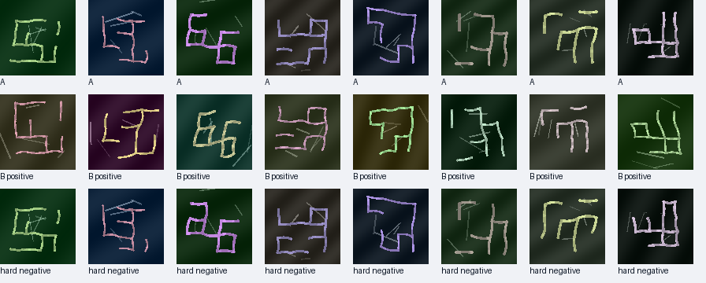
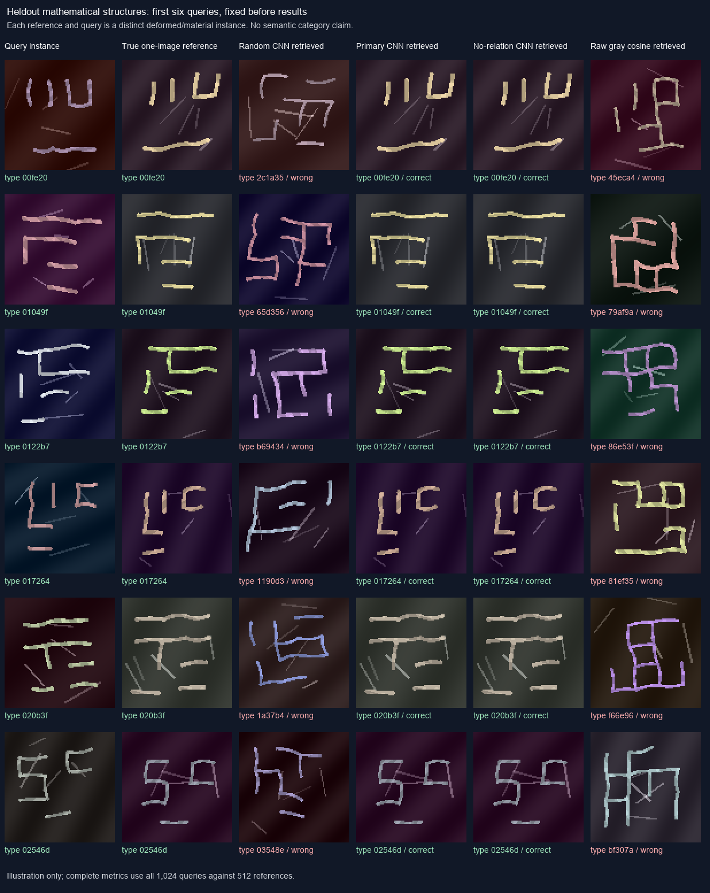

# HyperNet v16: independent shape instances and relationships

**The completed fresh comparison is mixed: v16 recovers more targets than the previous CNN, but fewer than raw-pixel correlation.** It also produces more false alarms than the previous CNN. This package includes the project's exact primary, matched-ablation and initial-random checkpoints, audited synthetic evidence, and aggregate fresh results.

The experiment tests whether a CNN trained on independently varied mathematical graph instances transfers better than the previous correspondence model to one-reference pattern retrieval. No borrowed weights, natural-image gradient training, teacher model or text encoder is used. One enrolled real image per target supplies a frozen descriptor; a separate labeled real calibration cohort selects a matching recipe and thresholds. This is not one real image of total supervision.

The synthetic grammar has 24 possible edges on a 4 by 4 lattice. Two positive instances retain the same edge arrangement while independently changing geometry, curvature, width, material and background. Hard negatives change the arrangement while matching specified nuisance factors and graph counts. The primary objective adds adjacency and node-degree prediction to type contrast, foreground, detail reconstruction and variance losses. The equal-budget ablation removes only the two relationship losses. Graph signatures are controlled mathematical types, not semantic object categories.



This is a fixed generated preview, not a real benchmark image. Each completed 4,096-step arm consumed 524,288 distinct rendered RGB views across 65,514 structural signatures, including hard-negative partners. The arms used the same pixels and initialization: 1,048,576 optimizer image exposures across both arms represent 524,288 unique images, not a million unique examples. The [independent training audit](benchmarks/synthetic/training_independent_audit.json) checks the full saved ledger; sampled renderer replay checks 48 recorded images per arm. It does not replay every optimizer update. See the exact [model contract](experiments/relational_model_contract.md).

## Measured synthetic result

All methods use one independently rendered reference for each of 512 held-out structural signatures and two new instances per signature, for 1,024 queries. Retrieval searches all 512 references.

| Method | Correct / queries | Top-1 retrieval |
|---|---:|---:|
| Primary CNN | 1,024 / 1,024 | 100% |
| Same CNN without relationship auxiliary losses | 1,024 / 1,024 | 100% |
| Native grayscale correlation | 48 / 1,024 | 4.69% |
| Same-architecture random initialization | 14 / 1,024 | 1.37% |

The relationship auxiliary losses show **no retrieval gain over the matched ablation** on this saturated diagnostic. These are results within a narrow generated graph grammar, not accuracy on natural objects or fresh Gravity Spy events. Perfect observed retrieval is not a guarantee of perfect population performance. [Aggregate results](benchmarks/synthetic/aggregate_results.json), [paired type bootstrap](benchmarks/synthetic/paired_type_bootstrap.json) and [raster overlap audit](benchmarks/synthetic/synthetic_raster_overlap_audit.json) record the protocol and checks.



The figure shows the first six declared diagnostic queries, not selected successes. Its images were replayed against saved input hashes; it adds no model run or metric.

## Install and check the package

Run commands from this directory. Install a PyTorch build appropriate for your hardware using the [official installation instructions](https://pytorch.org/get-started/locally/), then install the remaining recorded dependencies:

```powershell
python -m pip install -r requirements.txt
python publication/verify_source_package.py
python -m pytest -q tests
python scripts/one_reference.py --help
```

The tests use generated arrays, artificial score tables and temporary files. They do not fetch or evaluate the fresh Gravity Spy cohort. The package preserves the selected source files byte for byte; `source_manifest.json` records original logical paths and both hashes. No source edits are hidden as portability changes. The original local-only evaluation-admission test is omitted because one case requires a historical v15 result file.

## One reference without a benchmark dataset

Using the included completed project checkpoint, the generic CLI needs only your reference and query images:

```powershell
python scripts/one_reference.py --checkpoint training/primary_4096/final.pt --reference reference.png --query query.png --output my_comparison.json --device cpu --recipe native
```

The CLI never downloads weights, modifies weights or fits a threshold. It returns native-image and 128 by 128 context embedding cosines plus their equal mean. The example explicitly selects `native`, the recipe frozen using the benchmark's separate CALIB cohort; the generic CLI default remains `mean`. The native arm retains original image dimensions; the context arm intentionally resizes. Without `--threshold`, no alarm decision is returned. Scores are similarities, not probabilities, and arbitrary user images do not inherit a benchmark calibration. The result is whole-image pattern matching, not object localization.

## Train a separate replication

Choose new output directories; the trainer preserves existing runs. A small plumbing run is separate from the scientific budget:

```powershell
python scripts/train_relations.py --run training/my_smoke --steps 2 --batch-types 4 --size 64 --device cpu --smoke
python scripts/train_relations.py --run training/reproduction_primary --steps 4096 --variant primary --device cuda
python scripts/train_relations.py --run training/reproduction_no_relation_aux --steps 4096 --variant no_relation_aux --device cuda
```

Use the same declared seeds, input stream and full budget for the matched arms. The trainer records source snapshots, actual generated RGB/mask hashes and checkpoint tensor hashes. A new run is a replication and does not inherit the original run's admission or audit. Device and library changes can change floating-point or rendered bytes. The original runtime uses Python 3.12.10 and PyTorch 2.14.1+cu130; other recorded dependencies are in `requirements.txt`.

## Fresh real-pattern comparison

The metadata-only plan contains 2,419 fresh event/time-group representatives, 14 eligible target types and 390 other-label background events. Blind checks retained 2,413 events, excluding six exactly constant background plots without replacement; all target positive counts are unchanged. The six constants also matched prior constant pixels, so exclusion reason counts overlap. Target availability was fixed before image acquisition. Each retained target reuses its single v15 reference; all 1,579 old labeled calibration events are retained. The CNN does not train on those images, but recipe selection and threshold fitting are additional real supervision.

The fixed comparison includes the new primary CNN, its relationship-loss ablation, matching random initialization, the previous project CNN, and centered grayscale 48 by 48 raw correlation. Each method receives the same enrolled references and query crops. CALIB selected `native` among three predeclared new-model recipes; the same recipe applies to its ablation and random control. Every method's cutoffs were fixed before fresh scoring. No model was promoted using TEST.

| Method | Mean target recall | Mean false alarms / 10,000 negatives | Mean target AUROC |
|---|---:|---:|---:|
| v16 primary | 12.34% | 25.85 | 0.745 |
| Without relationship losses | 6.17% | 12.59 | 0.785 |
| Same-architecture random | 1.05% | 6.33 | 0.706 |
| Previous v15 | 0.42% | 4.95 | 0.729 |
| Raw grayscale 48 by 48 | 15.72% | 34.65 | 0.763 |

These are equally weighted means over the fixed 14 targets, not classification accuracy. All methods' thresholds were fitted to a 10-false-alarms-per-10,000 CALIB budget. The primary, raw control and relationship-loss ablation exceeded that budget on fresh events. Comparing their recalls does not establish a gain at the same achieved TEST false-alarm rate.

The primary-minus-raw recall difference is **−3.37 percentage points**, with a 95% paired time-group bootstrap interval of **−5.80 to −0.85 points**. Its false-alarm difference is **−8.80 per 10,000**, interval **−17.05 to −0.83**. Relationship losses increase both recall and false alarms relative to the matched ablation, while producing lower AUROC; the experiment does not establish an overall win for those losses. No TEST threshold adjustment or recipe change was applied.

[Full aggregate metrics and thresholds](benchmarks/fresh_aggregate_results.json), [paired uncertainty](benchmarks/fresh_paired_analysis.json), [independent arithmetic audit](benchmarks/fresh_independent_score_audit.json) and [exact replay summary](benchmarks/fresh_inference_replay_summary.json) preserve the result. The independent audit checks all 168,910 target scores. The predeclared two-query replay matches all 140 scores exactly using the original batch context; it is not a replay of every inference or optimizer step. The local scientific test selection passed 43 tests; this standalone package passed 47 tests, including its explicitly collected synthetic data-guard tests and excluding three cases in a file with a private historical dependency.

The fresh labels come from a single verified volunteer workflow/version, requiring at least five distinct consistent registered voters and 80% agreement. Machine labels are not used as ground truth. Human consensus remains fallible and ML-routed; this filtered cohort is not natural class prevalence. Whole same-detector connected four-second groups overlapping known prior events are excluded. Blind constant/duplicate-image exclusions have no replacements.

The public package deliberately omits event-level derived annotations, event-linked scores, images and real-image figures. It includes aggregate class metrics, thresholds and hash commitments. [Reconstruction notes](REPRODUCTION.md) describe the separate official-source and legacy-input steps; fresh benchmark reproduction is not a self-contained one-command download. [Data terms](THIRD_PARTY_DATA.md) apply independently of this code, and this package introduces no new project license grant.

False alarms per 10,000 are normalized from the observed negative counts, not evidence that 10,000 independent negatives were tested. Actual per-target negative samples range from 1,925 to 2,395, insufficient to certify extremely rare false alarms. One-reference morphology retrieval is distinct from synthetic graph classification, ordinary object recognition and industrial anomaly detection.
